
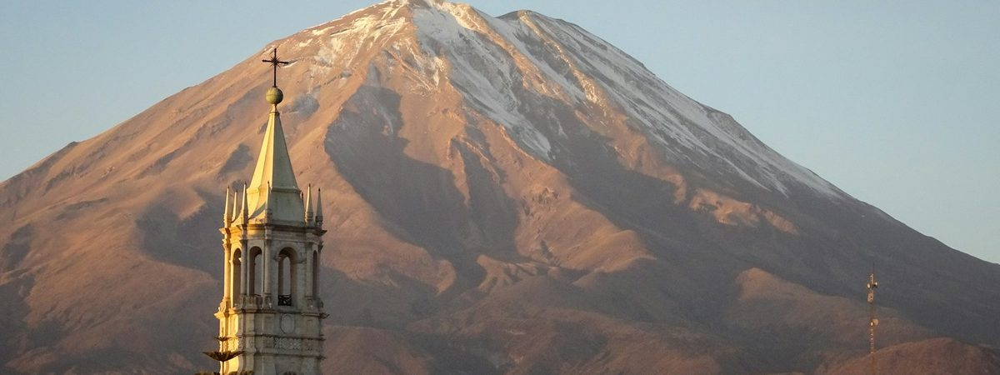

# Awesome Ecosistema de Innovación y Tecnología de Arequipa, Perú

<a href="https://arequipa-sillar-connect.lovable.app">Web</a> · <a href="https://arequipa-sillar-connect.lovable.app/guia">Guía</a> · <a href="https://ignacio-velasquez.notion.site/Directorio-Ecosistema-Arequipa-3f2da2435b468151bbadd79211050be0">Notion</a> · <a href="https://www.pampam.city/ecosistema-de-innovacion-de-arequipa-5cJmBIAEiXBQ0yQw4bfp">Mapa PamPam</a> · <a href="https://tiermaker.com/list/technology/ecosistema-de-innovacin-de-arequipa-19907354/6679308">Ranking TierMaker</a>

Directorio curado del **ecosistema de innovación** y tecnología de **Arequipa, Perú**. Reúne **106 actores** en **13 categorías** — universidades, incubadoras, comunidades tech, espacios de innovación, startups, eventos y más. Incluye **6** universidades, **11** institutos, **7** incubadoras y aceleradoras, **14** comunidades tech, **17** espacios de innovación, **10** startups y **7** eventos recurrentes, además de entidades públicas, oficinas universitarias de innovación, fundaciones, gremios, medios y redes. **95** entradas tienen foto real; cada ficha enlaza a su fuente pública.

**106 actores** · **95** con foto real · cada entrada enlaza a su **fuente pública**. Créditos de imágenes en [`assets/covers/SOURCES.md`](assets/covers/SOURCES.md).

Ranking por categoría en [Tier Maker](https://tiermaker.com/list/technology/ecosistema-de-innovacin-de-arequipa-19907354/6679308).

## Contenido

- [🎓 Universidades](#-universidades) (6)
- [🛠️ Institutos y escuelas técnicas](#-institutos-y-escuelas-técnicas) (11)
- [🚀 Incubadoras y aceleradoras](#-incubadoras-y-aceleradoras) (7)
- [👩‍💻 Comunidades tech](#-comunidades-tech) (14)
- [🏢 Espacios de innovación](#-espacios-de-innovación) (17)
- [🏛️ Estado y programas](#-estado-y-programas) (11)
- [🔬 Oficinas de innovación universitaria](#-oficinas-de-innovación-universitaria) (4)
- [🤝 Fundaciones](#-fundaciones) (2)
- [🧾 Cámaras y gremios](#-cámaras-y-gremios) (2)
- [📰 Medios](#-medios) (13)
- [💰 Fondos e inversión](#-fondos-e-inversión) (0)
- [📅 Eventos](#-eventos) (7)
- [🕸️ Redes](#-redes) (2)
- [🚀 Startups](#-startups) (10)
- [Datos](#datos)
- [Ranking por categoría (Tier Maker)](https://tiermaker.com/list/technology/ecosistema-de-innovacin-de-arequipa-19907354/6679308)
- [Contribuir](#contribuir)

## 🎓 Universidades

| | Actor | Descripción | Fuente |
|:-:|---|---|:-:|
| 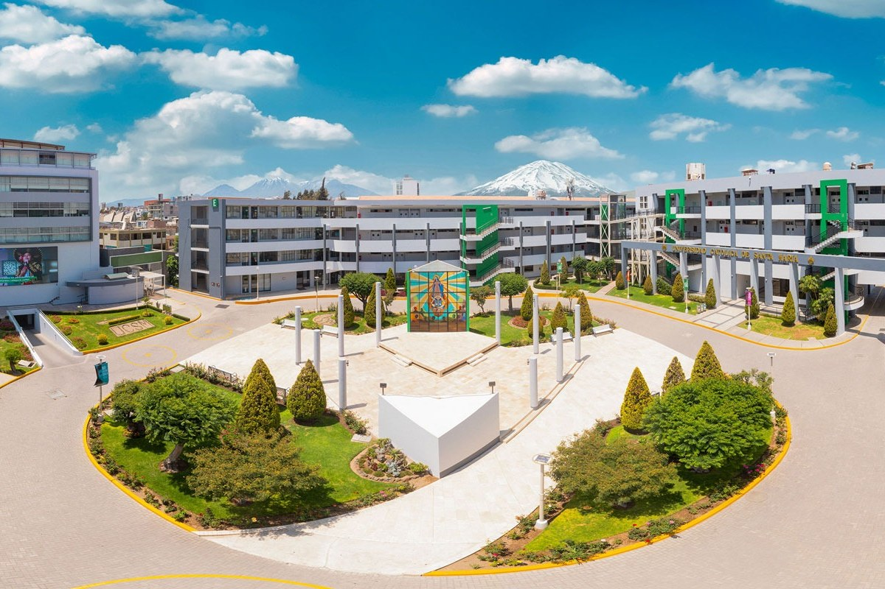 | [Universidad Católica de Santa María (UCSM)](https://www.ucsm.edu.pe)  📍 Yanahuara (según OSM) | Universidad privada; opera la incubadora INNICIA (modelo Venture Studio con ProInnóvate) y codirige DER Arequipa 3.0. | [🔗](https://calidadynegocios.com/arequipa-tecnologica-innicia-presenta-startups-y-su-modelo-venture-studio/) |
| 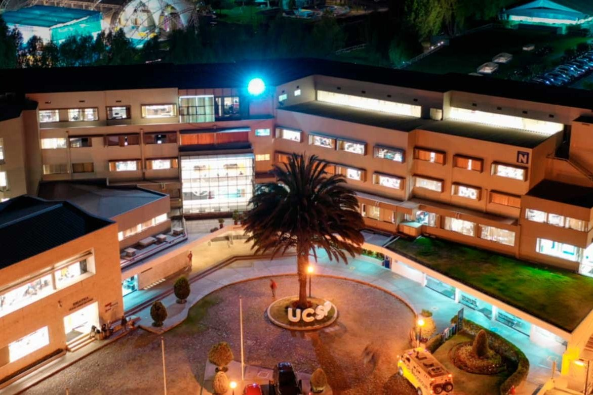 | [Universidad Católica San Pablo (UCSP)](https://ucsp.edu.pe) | Universidad privada con Ciencia de la Computación; opera la incubadora Kaman y coorganizó VINCULATECH Empresarial 2026 con Concytec. | [🔗](https://ucsp.edu.pe/en/noticias/arequipa-vinculatech-empresarial-ciencia-empresa-estado/) |
| 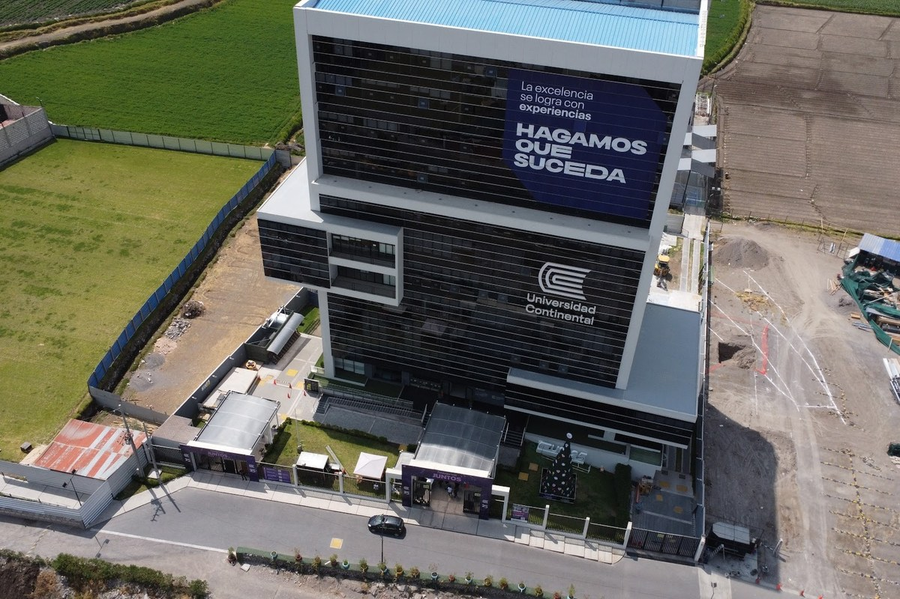 | [Universidad Continental – Arequipa](https://ucontinental.edu.pe)  📍 José Luis Bustamante y Rivero | Universidad privada; en Arequipa opera Wichay Continental, Centro Digital Continental y un Fab Lab. | [🔗](https://fablab.ucontinental.edu.pe/fab-lab-arequipa/) |
| 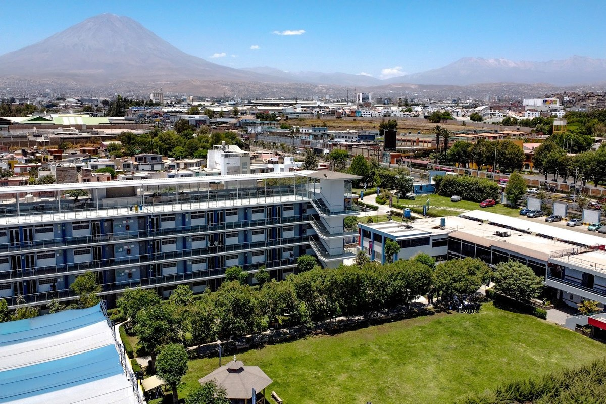 | [Universidad La Salle (ULaSalle)](https://www.ulasalle.edu.pe)  📍 Arequipa (Cercado según web; OSM: J. Hunter) | Universidad privada con Ingeniería de Software; opera la Incubadora Parmenia. | [🔗](https://www.ulasalle.edu.pe/presentacion-demoday-primer-programa-de-pre-incubacion-1g-incubadora-parmenia/) |
| 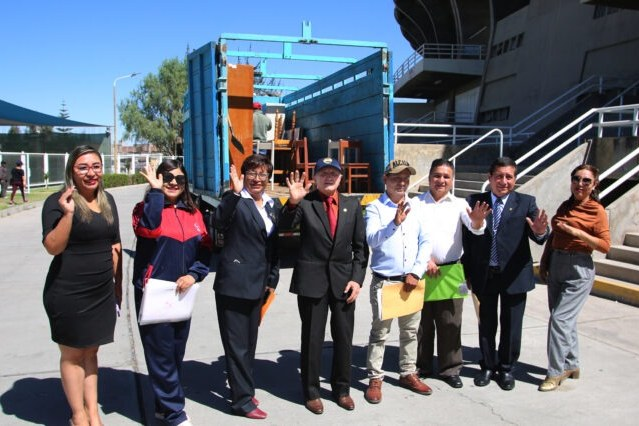 | [Universidad Nacional de San Agustín de Arequipa (UNSA)](https://www.unsa.edu.pe)  📍 Arequipa (Cercado) | Universidad pública; aloja la incubadora JAKU Emprende, el Parque Científico Tecnológico y capítulos estudiantiles ACM/IEEE. | [🔗](https://www.unsa.edu.pe/14-equipos-innovan-con-inteligencia-artificial-en-hackathon-nexia-2026/) |
| 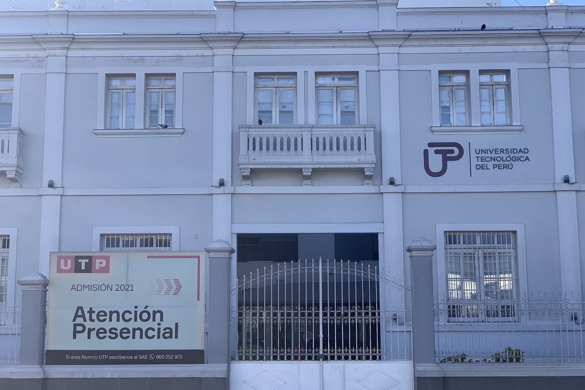 | [Universidad Tecnológica del Perú (UTP) – Arequipa](https://www.utp.edu.pe)  📍 Arequipa (Cercado) | Universidad privada con campus Arequipa; programa StartUP UTP de incubación estudiantil (nacional). | [🔗](https://www.utp.edu.pe/como-llegar) |

[⬆ volver](#contenido)

## 🛠️ Institutos y escuelas técnicas

| | Actor | Descripción | Fuente |
|:-:|---|---|:-:|
|  | [Certus – Sede Arequipa](https://www.certus.edu.pe/sede/arequipa/)  📍 José Luis Bustamante y Rivero | Escuela de educación superior licenciada por MINEDU; su sede de 9 pisos (32 aulas, 12 laboratorios digitales) ofrece Diseño y Desarrollo de Software y Administración de Sistemas. | [🔗](https://www.certus.edu.pe/sede/arequipa/) |
| 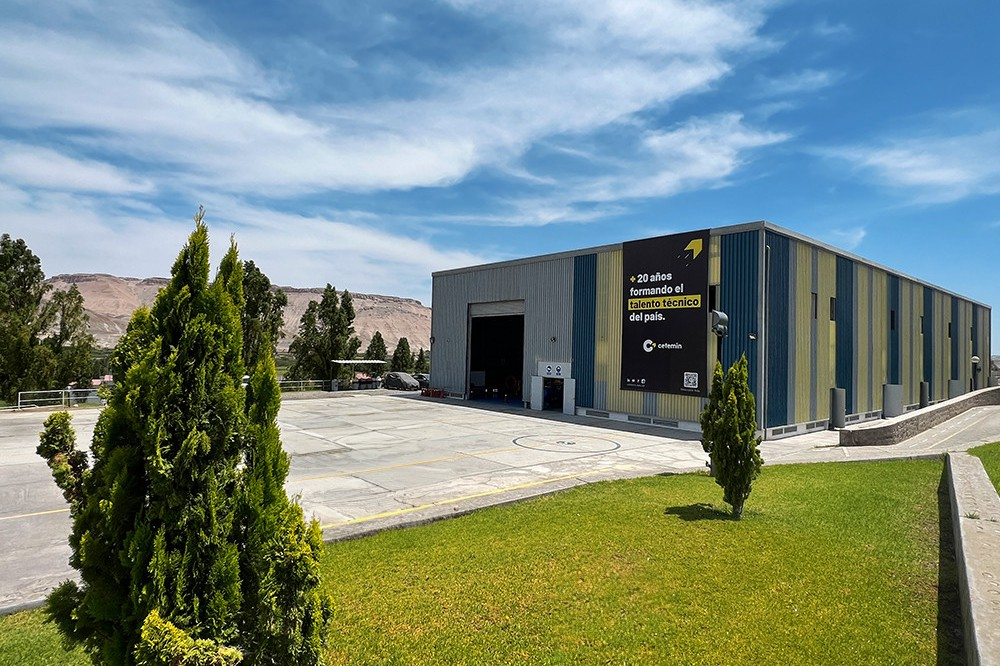 | [CETEMIN – Campus Arequipa (Fernando Chaves Belaunde)](https://www.cetemin.edu.pe/sedes)  📍 Vítor | Instituto técnico especializado en minería, maquinaria pesada y procesos industriales; campus de prácticas en Vítor y oficina en JLByR. | [🔗](https://www.cetemin.edu.pe/sedes) |
|  | [IDAT – Campus Arequipa](https://www.idat.edu.pe/campus/arequipa)  📍 Cayma | Instituto técnico del grupo Intercorp; en Arequipa dicta Computación e Informática, Diseño Gráfico, Contabilidad y Administración. | [🔗](https://www.idat.edu.pe/campus/arequipa) |
| 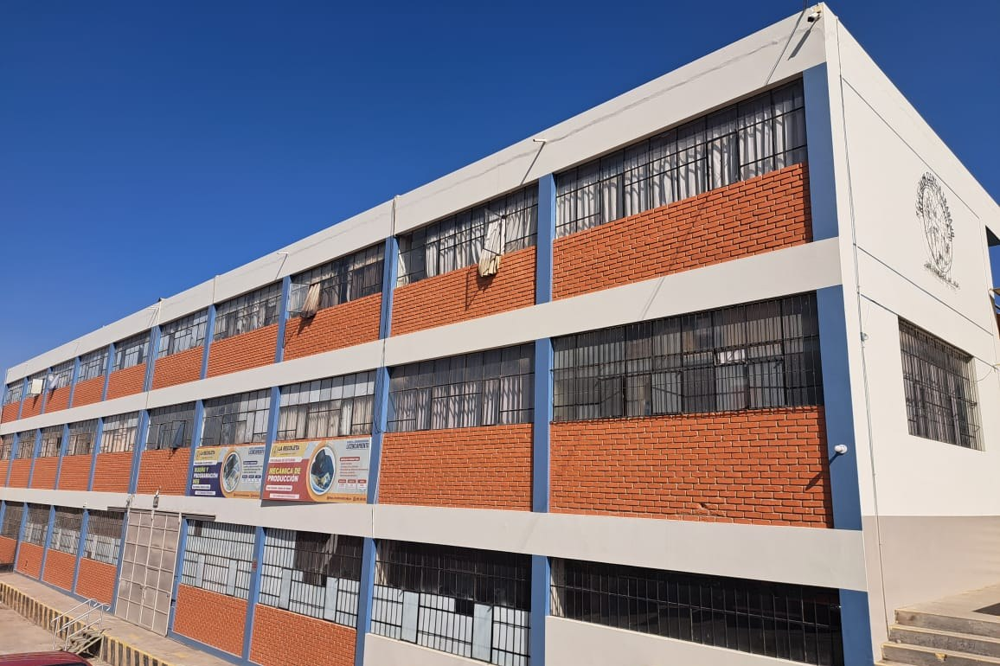 | [IEST La Recoleta](https://iestlarecoleta.edu.pe/)  📍 Arequipa (Cercado) | Instituto de educación superior tecnológico con la carrera de Diseño y Programación Web; organiza la Jornada de Actualización Tecnológica (IA, protección de datos, fabricación aditiva). | [🔗](https://jat2025.iestlarecoleta.edu.pe/) |
| 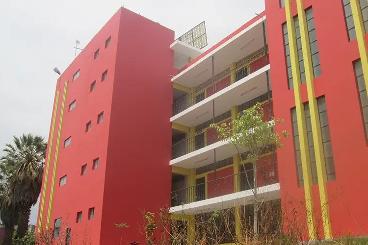 | [IESTP Pedro P. Díaz](https://iestp-ppd.edu.pe/)  📍 José Luis Bustamante y Rivero | Instituto de educación superior tecnológico público; nueve programas, entre ellos Desarrollo de Sistemas de Información y Electrónica Industrial. En camino a ser el primer instituto público licenciado de Arequipa. | [🔗](https://www.gob.pe/institucion/regionarequipa/noticias/1374817-iestp-pedro-p-diaz-se-convertira-en-el-primer-instituto-publico-de-arequipa-en-obtener-el-licenciamiento) |
| 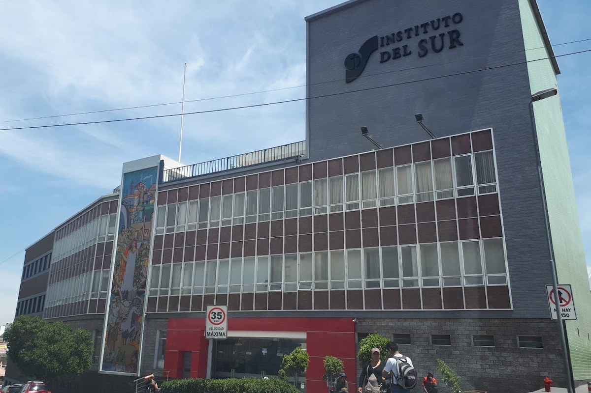 | [ISUR – Instituto del Sur](https://www.isur.edu.pe/)  📍 Arequipa (Cercado) | Instituto de educación superior arequipeño (34 años); su Unidad Académica de Tecnologías de Información dicta Desarrollo de Sistemas de Información (Java, Python, bases de datos, seguridad con certificación Cisco). | [🔗](https://www.isur.edu.pe/contactanos/) |
| 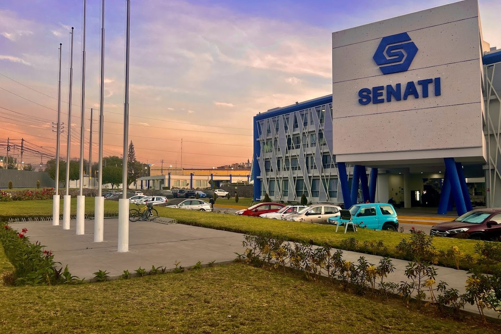 | [SENATI – Sede Arequipa](https://www.senati.edu.pe/sedes)  📍 Arequipa (Cercado) | Sede de la zonal Arequipa–Puno del SENATI; su centro tecnológico de 4 pisos incluye Tecnología de la Información, Mecatrónica y Tecnología Ambiental. | [🔗](https://www.senati.edu.pe/sedes) |
|  | [Tecsup – Sede Arequipa](https://www.tecsup.edu.pe/sede/sede-arequipa/)  📍 José Luis Bustamante y Rivero | Instituto tecnológico (educación superior técnica); sede habitual de eventos de GDG Arequipa y Women Techmakers. | [🔗](https://www.tecsup.edu.pe/sede/sede-arequipa/) |
| 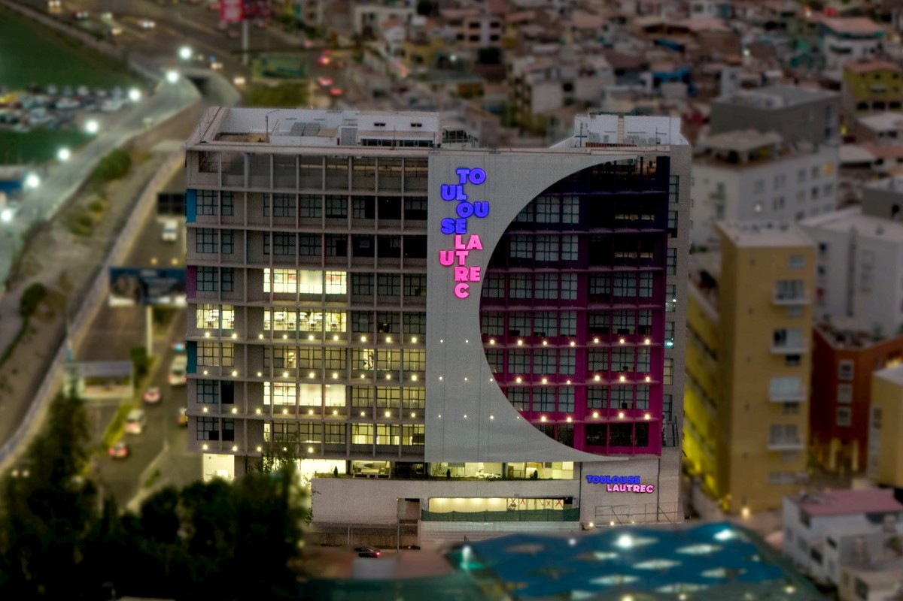 | [Toulouse Lautrec – Sede Arequipa](https://www.toulouselautrec.edu.pe/sedes/arequipa)  📍 Arequipa (Cercado) | Escuela de industrias creativas y digitales (carreras de bachiller y técnicas) con sede propia en Arequipa. | [🔗](https://www.toulouselautrec.edu.pe/sedes/arequipa) |
| 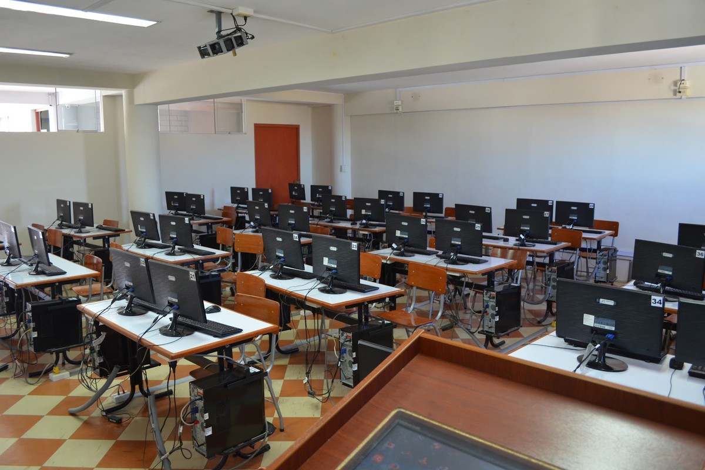 | [UNITEK – Instituto de Educación Superior (Arequipa)](https://unitek.edu.pe/)  📍 Sachaca | Instituto privado arequipeño (desde 1985, ex 'Albert Einstein'); dicta Desarrollo de Sistemas de Información y Enfermería Técnica, con laboratorios de cómputo. | [🔗](https://unitek.edu.pe/contactanos/) |
| 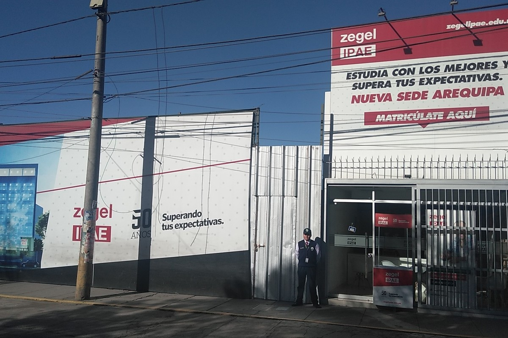 | [Zegel – Campus Arequipa](https://www.zegel.edu.pe/campus/arequipa)  📍 Cayma | Instituto de educación superior (ex IPAE) con carreras técnicas de negocios y tecnología; inauguró su campus Arequipa en Cayma. | [🔗](https://www.zegel.edu.pe/campus/arequipa) |

[⬆ volver](#contenido)

## 🚀 Incubadoras y aceleradoras

| | Actor | Descripción | Fuente |
|:-:|---|---|:-:|
| 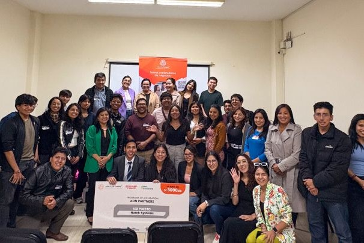 | [ADN Partners](https://adnpartners.com.pe) | Aceleradora privada no convencional con sede en Arequipa (fundada 2025): formación, mentoría y acceso a inversión. | [🔗](https://es.linkedin.com/posts/adnpartners_dimos-inicio-al-programa-de-aceleraci%C3%B3n-activity-7425575823539081217-stSA) |
| 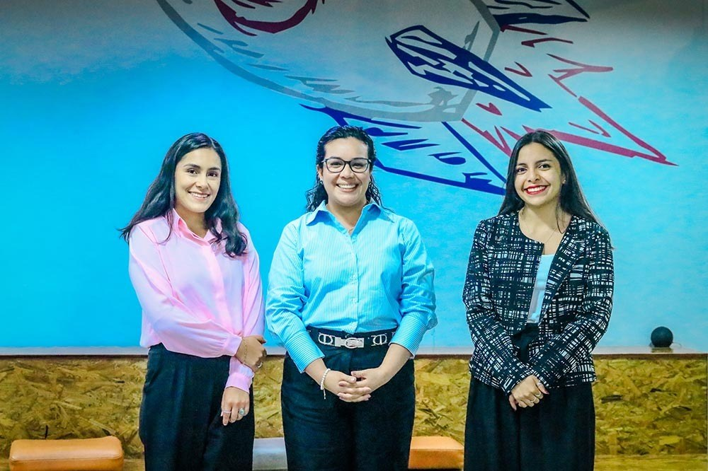 | [Incubadora de Negocios Kaman – UCSP](https://ucsp.edu.pe/kaman/presentacion/)  📍 Arequipa (Vallecito) | Incubadora/aceleradora de la UCSP con coworking para emprendedores (planes Start/Growth/Advance); red ProInnóvate. | [🔗](https://ucsp.edu.pe/agenda/planes-acompanamiento-kaman/) |
|  | [Incubadora Parmenia – Universidad La Salle](https://www.ulasalle.edu.pe)  📍 Arequipa (Cercado) | Incubadora de negocios de ULaSalle (pre-incubación 1G, Demoday). NO figura en la red de 38 incubadoras ProInnóvate (PRODUCE, may-2026). | [🔗](https://www.ulasalle.edu.pe/presentacion-demoday-primer-programa-de-pre-incubacion-1g-incubadora-parmenia/) |
| 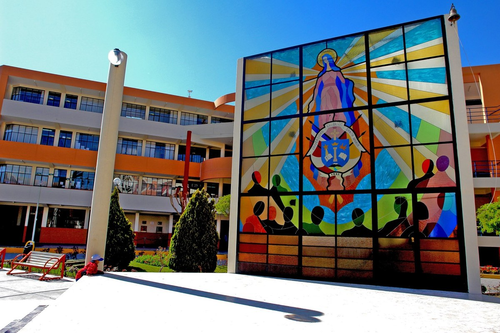 | [INNICIA – Incubadora de Empresas UCSM](https://investigacion.ucsm.edu.pe/innicia/)  📍 Yanahuara (campus UCSM) | Incubadora de la UCSM; modelo Venture Studio (ProInnóvate): 280 startups apoyadas 2023-2025; programa Órbita. | [🔗](https://calidadynegocios.com/arequipa-tecnologica-innicia-presenta-startups-y-su-modelo-venture-studio/) |
| 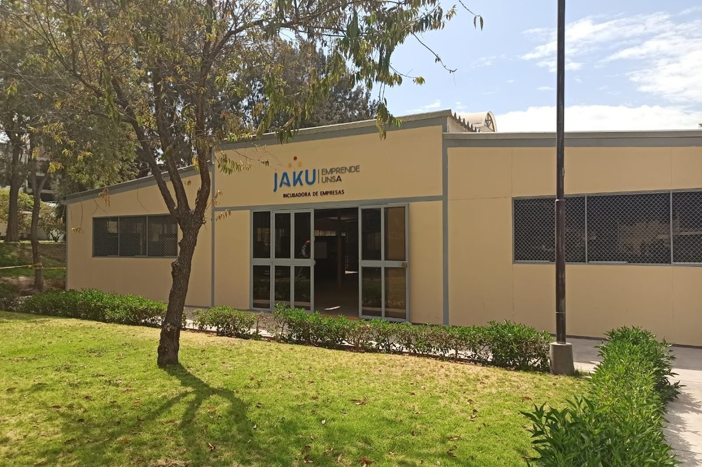 | [JAKU Emprende UNSA](https://www.unsa.edu.pe/jaku/)  📍 Arequipa (Cercado) | Incubadora de empresas de la UNSA (pre-incubación Wichariy, incubación Sisay, PEM); red ProInnóvate. | [🔗](https://www.unsa.edu.pe/jaku/programas/) |
| 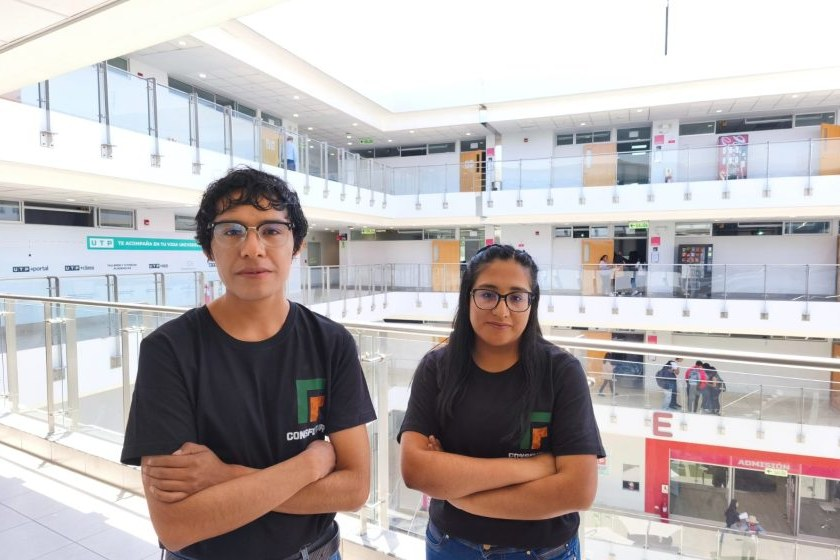 | [StartUP UTP](https://empleabilidad.utp.edu.pe/alumnos/startup-utp) | Programa de incubación de emprendimientos estudiantiles de la UTP (nacional, incluye sedes regionales). | [🔗](https://empleabilidad.utp.edu.pe/alumnos/startup-utp) |
| 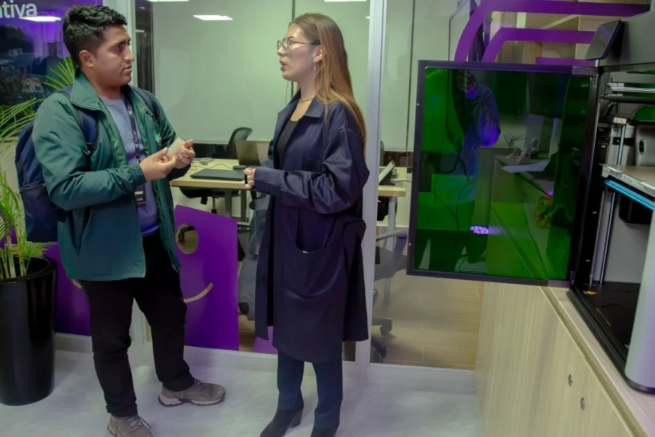 | [Wichay Continental](https://wichay.pe/incubadora) | Incubadora multiregional de la U. Continental con presencia y coworking en Arequipa; red ProInnóvate (registrada en Huancayo). | [🔗](https://wichay.pe/incubadora) |

[⬆ volver](#contenido)

## 👩‍💻 Comunidades tech

| | Actor | Descripción | Fuente |
|:-:|---|---|:-:|
| 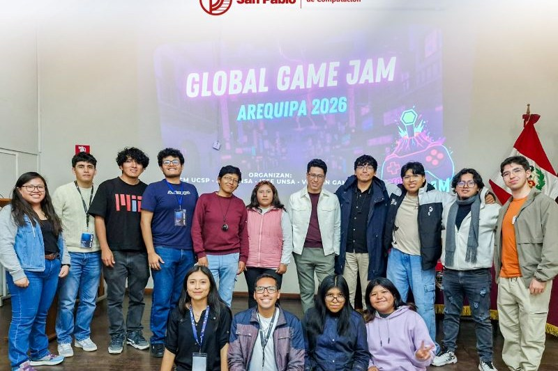 | **ACM Student Chapter UNSA**  📍 Arequipa | Capítulo estudiantil ACM (comités de robótica, desarrollo web, Women in Computing). | [🔗](https://es.linkedin.com/posts/acm-student-chapter-universidad-nacional-de-san-agust%C3%ADn-de-arequipa_acmunsa-desarrolloweb-nuevadirectiva2026-activity-7452484406432358400-L0Zk) |
| 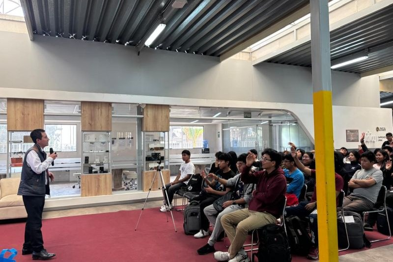 | [AWS User Group Arequipa](https://www.meetup.com/aws-user-group-arequipa/) | Comunidad AWS (Meetup Pro); meetups presenciales, híbridos y virtuales. | [🔗](https://www.meetup.com/aws-user-group-arequipa/) |
|  | **Bitcoin Arequipa** | Comunidad de educación/adopción de Bitcoin (canal Telegram). | [🔗](https://t.me/btcarequipa) |
| 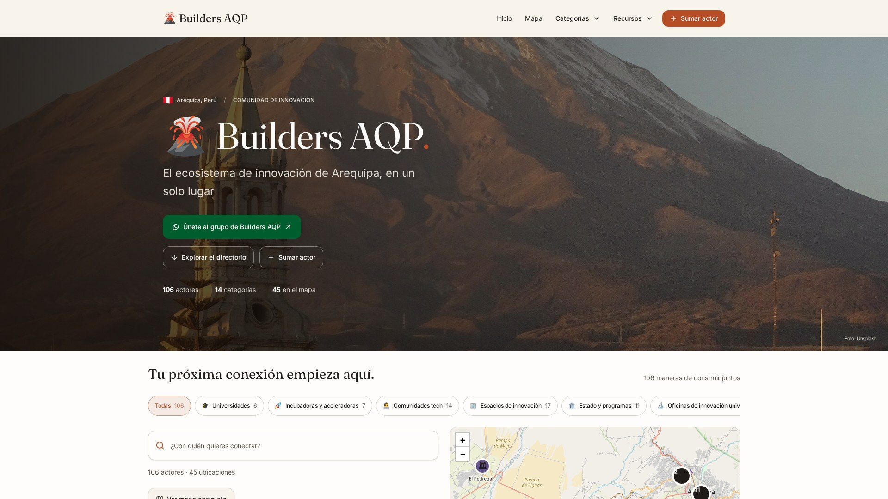 | [Builders AQP](https://chat.whatsapp.com/DRnsjRXsGAnBIHDbURndIn?mode=gi_t) | Comunidad de builders (personas que construyen productos y proyectos tech) de Arequipa, organizada por Ignacio; se coordina por grupo de WhatsApp. | [🔗](https://chat.whatsapp.com/DRnsjRXsGAnBIHDbURndIn?mode=gi_t) |
| 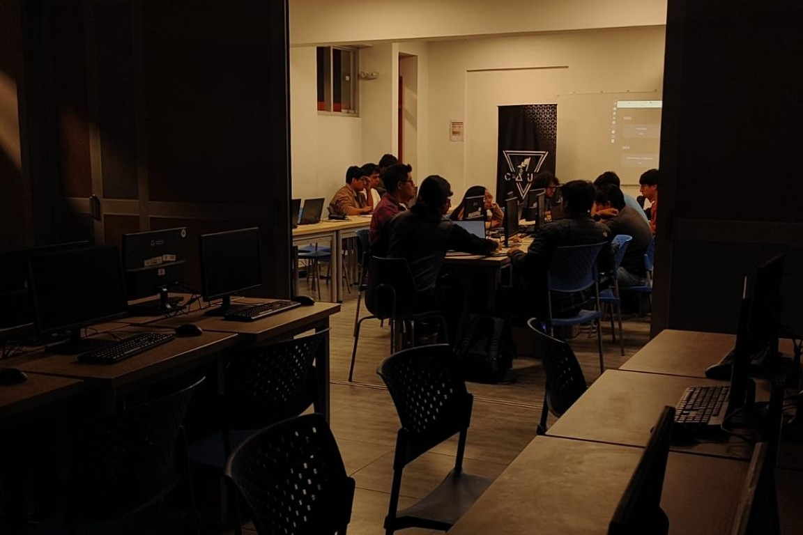 | [Comunidad Arequipeña de Ciberseguridad (CAUC)](https://linkedin.com/company/comunidad-cauc) | Comunidad de estudiantes universitarios de Arequipa dedicada a ciberseguridad: talleres, CTF, charlas y alianzas (ISC UNSA, Ekoparty/EkoGroup). | [🔗](https://es.linkedin.com/posts/comunidad-cauc_ciberseguridad-cybersecurity-arequipa-activity-7417749321489575936-9NTE) |
| 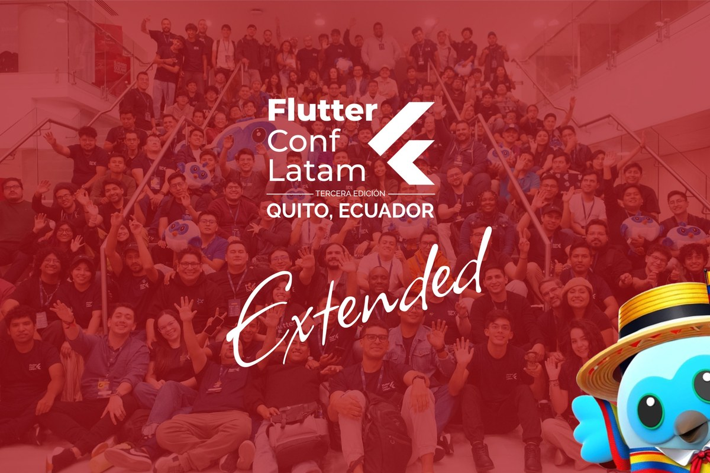 | [Flutter Arequipa](https://www.meetup.com/flutter-arequipa/) | Comunidad local de desarrolladores Flutter: charlas, meetups presenciales y exposición de apps hechas por la comunidad. | [🔗](https://www.meetup.com/flutter-arequipa/) |
| 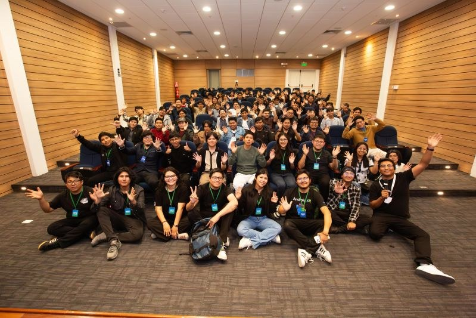 | [GDG Arequipa](https://gdg.community.dev/gdg-arequipa/) | Google Developer Group local (~1,447 miembros); organiza DevFest, I/O Extended, Build with AI. | [🔗](https://gdg.community.dev/gdg-arequipa/) |
|  | **Hult Prize at UNSA**  📍 Arequipa | Capítulo universitario del Hult Prize (emprendimiento social). | [🔗](https://linkedin.com/company/hult-prize-at-unsa) |
| 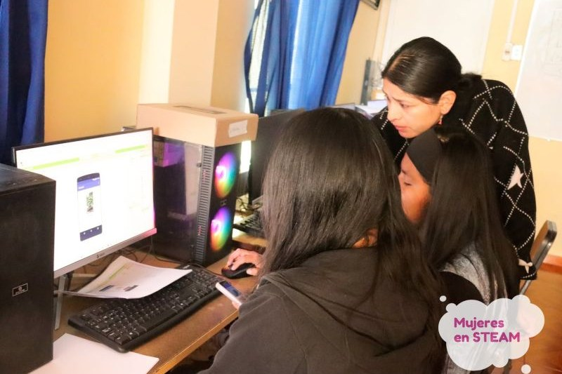 | **Mujeres en STEAM** | Comunidad de mujeres en tecnología/ciencia; co-impulsó el IV Encuentro de Mujeres en Ingeniería y Computación (UCSP). | [🔗](https://es.linkedin.com/posts/mujeres-en-steam_iv-encuentro-de-mujeres-en-ingenier%C3%ADa-y-computaci%C3%B3n-activity-7435895610785927168-6vw7) |
| 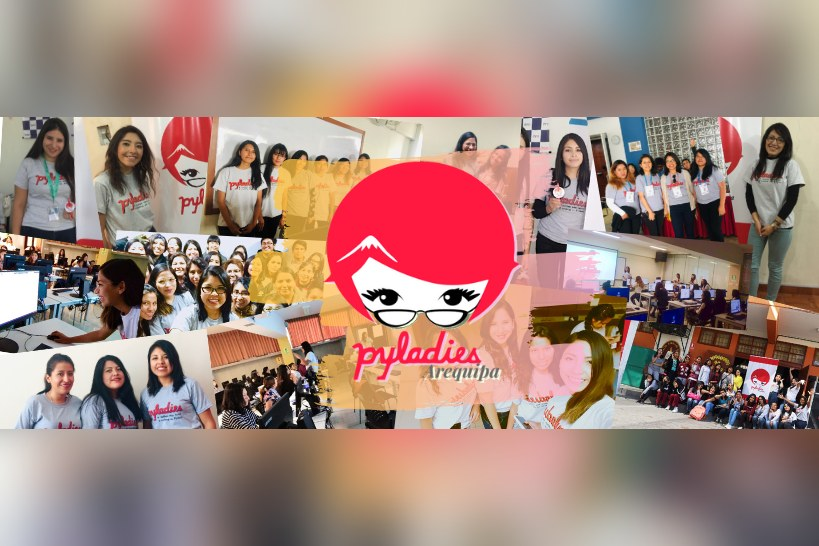 | [PyLadies Arequipa](https://pyladiesaqp.blogspot.com/) | Capítulo PyLadies: Python y brecha de género (talleres, grupos de estudio). | [🔗](https://linkedin.com/company/pyladies-aqp) |
| 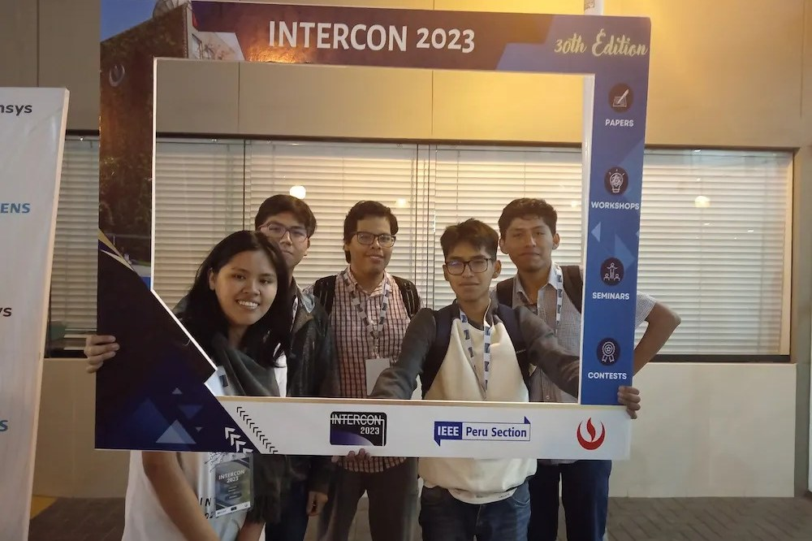 | [Rama Estudiantil IEEE UNSA](https://ieee-ynoacamino.vercel.app/)  📍 Arequipa | Rama estudiantil IEEE (con capítulos Computer Society y WIE). | [🔗](https://es.linkedin.com/posts/student-branch-ieee-unsa_ieee-ieeeunsa-studentbranch-activity-7462128255681200128-ReNF) |
| 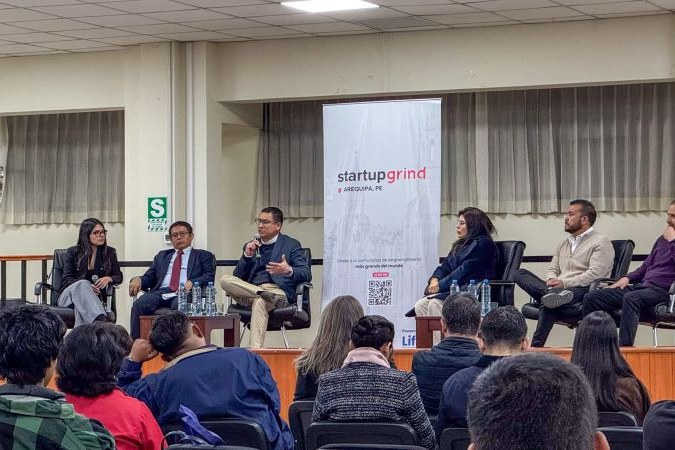 | [Startup Grind Arequipa](https://www.startupgrind.com/arequipa/) | Capítulo local de Startup Grind (~3,433 miembros); co-dirigido con Sumatec. | [🔗](https://www.startupgrind.com/arequipa/) |
| 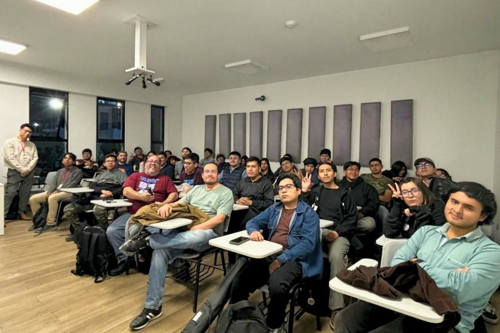 | **Volcán Game Lab** | Comunidad sin fines de lucro de desarrolladores de videojuegos y juegos de mesa de Arequipa (desde 2025): meetups, Board Game Jam, Volcán Game Jam y coorganización de la Global Game Jam Arequipa. | [🔗](https://es.linkedin.com/posts/volcan-game-lab_volc%C3%A1ngamelab-arequipagamedev-gamedev-activity-7413102503770324992-oIQa) |
| 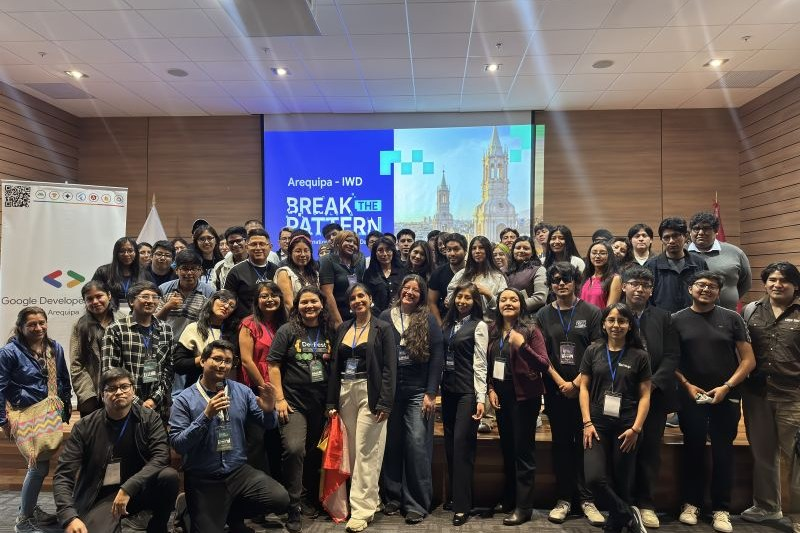 | **Women Techmakers Arequipa** | Capítulo WTM aliado a GDG Arequipa. | [🔗](https://www.linkedin.com/posts/womentechmakers-arequipa_activity-7463677543720673280-llG4) |

[⬆ volver](#contenido)

## 🏢 Espacios de innovación

| | Actor | Descripción | Fuente |
|:-:|---|---|:-:|
| 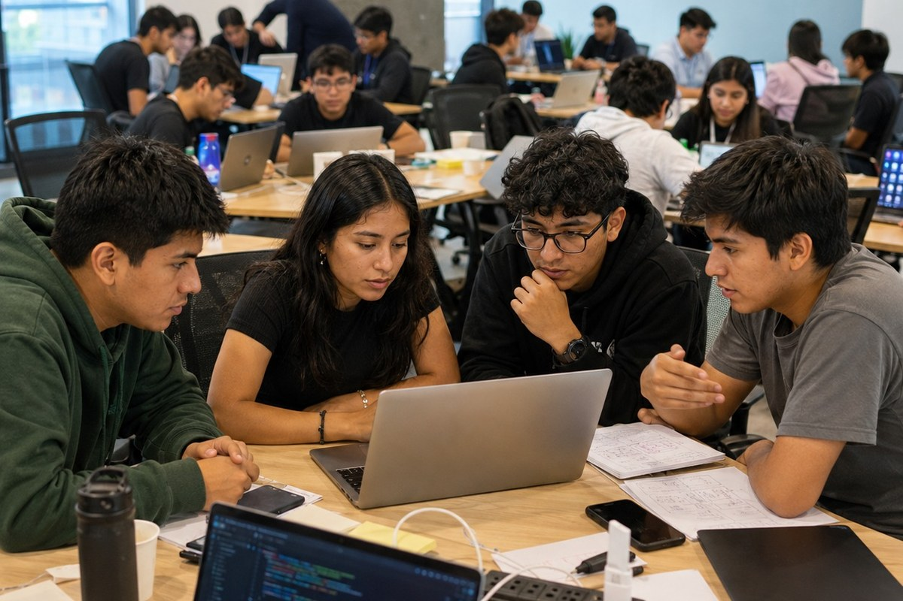 | [Centro Digital Continental – Arequipa](https://centrodigitalcontinental.pe/)  📍 Cayma | Hub de transformación digital para mipymes (coworking, impresión 3D, kit audiovisual), cofinanciado por ProInnóvate. | [🔗](https://luma.com/k4q2db1b) |
| 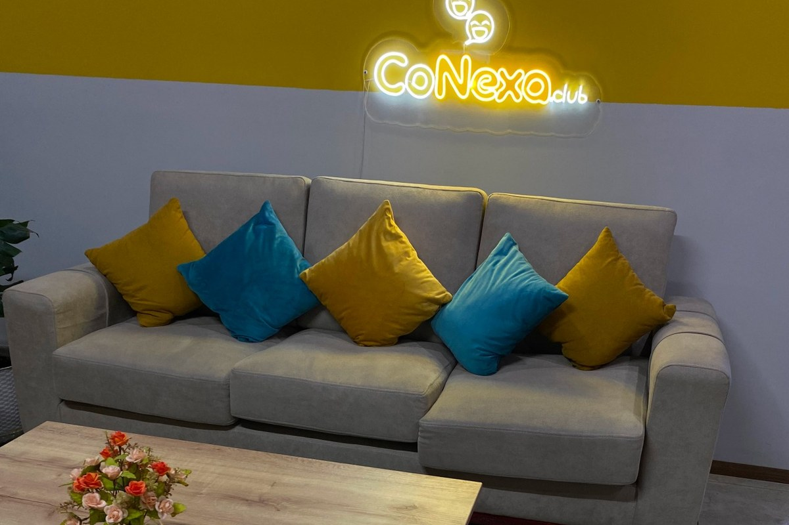 | [CoNexa Coworking](https://conexacoworking.com/)  📍 Arequipa | Coworking con 3 sedes listadas (Lazo de los Ríos 308, C. Perú 204, La Recoleta 213). | [🔗](https://exa.ai/library/places?q=ecd8d40323efd6d1) |
| 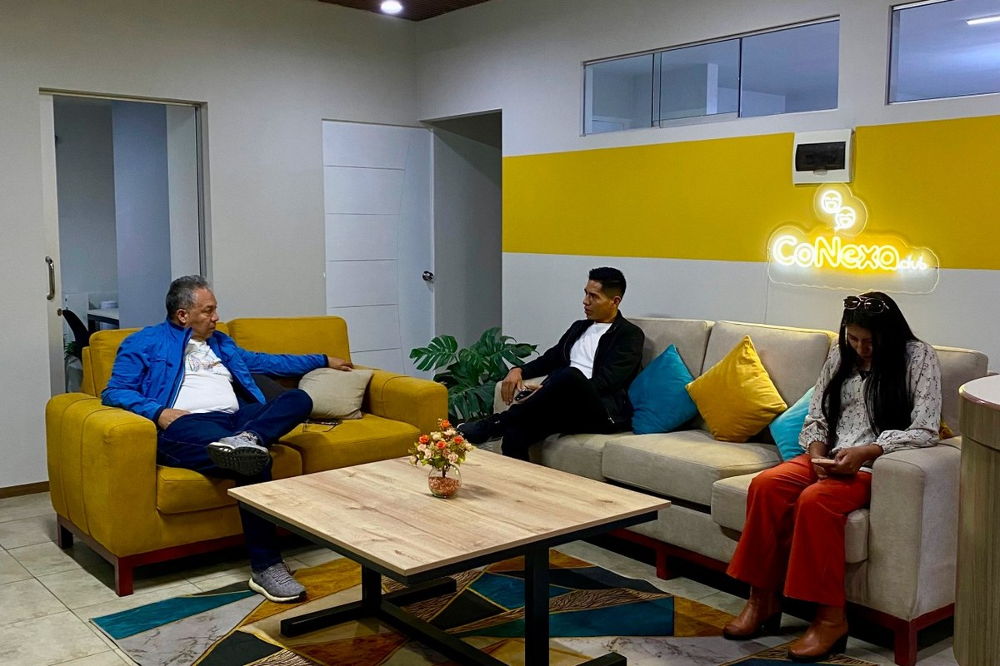 | [CoNexa Coworking – C. Perú](https://conexacoworking.com/) | Coworking con tres sedes en Arequipa; esta es la sede de C. Perú. | [🔗](https://exa.ai/library/places?q=ecd8d40323efd6d1) |
| 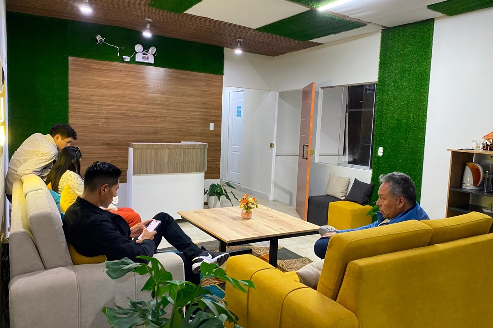 | [CoNexa Coworking – La Recoleta](https://conexacoworking.com/) | Coworking con tres sedes en Arequipa; esta es la sede de La Recoleta. | [🔗](https://exa.ai/library/places?q=ecd8d40323efd6d1) |
| 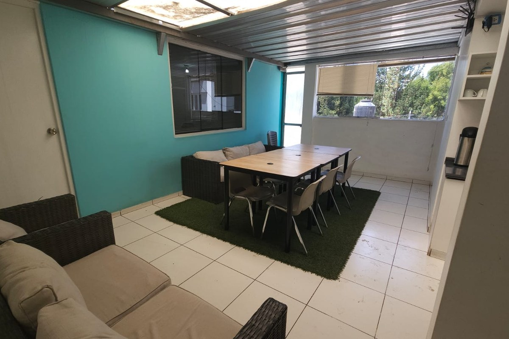 | **Coworking Arequipa Works**  📍 Yanahuara | Coworking en Yanahuara (baja valoración pública). | [🔗](https://exa.ai/library/place/hbkv4p55z5m) |
| 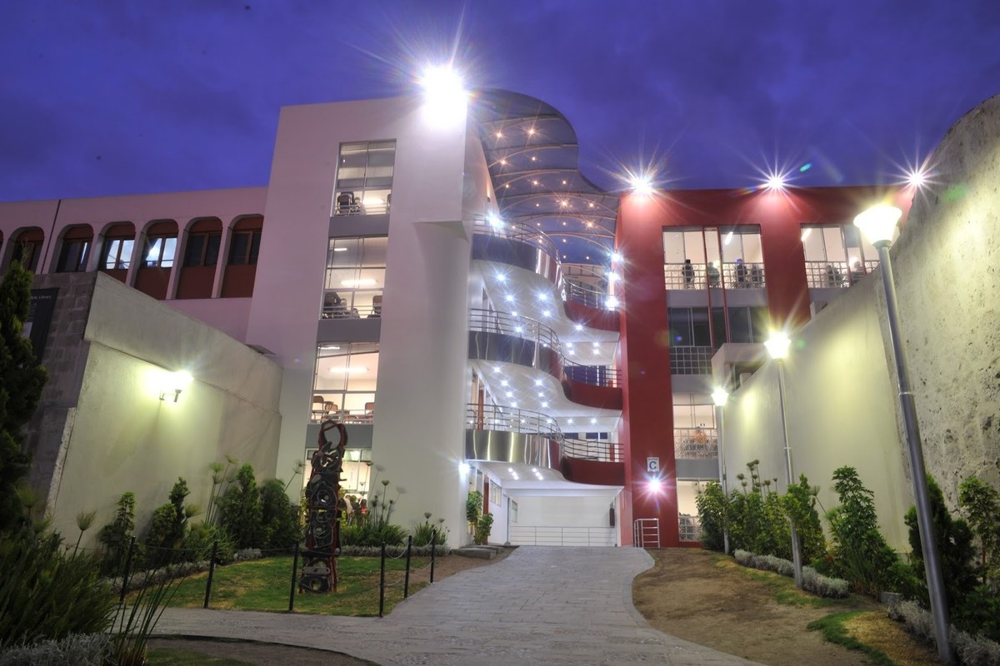 | **Coworking CCPNA**  📍 Arequipa (San Lázaro) | Espacio de coworking del Centro Cultural Peruano Norteamericano. | [🔗](https://exa.ai/library/places?q=ecd8d40323efd6d1) |
| 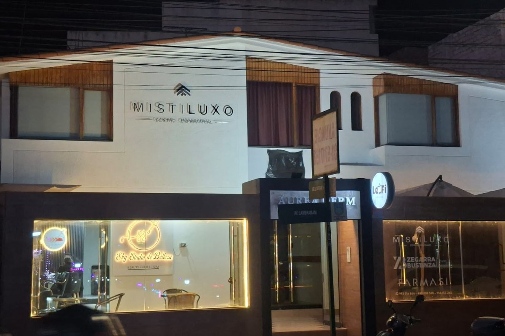 | **Coworking Mistiluxo**  📍 José Luis Bustamante y Rivero (aprox.) | Oficina/coworking listado públicamente. | [🔗](https://exa.ai/library/place/wdrmy6v4b9x) |
| 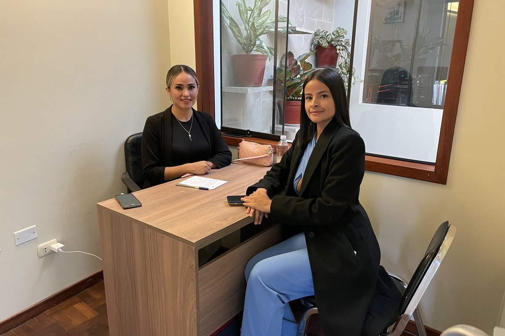 | [Coworkinghouse Arequipa (CoworkInHouse)](https://coworkinghouse.pe)  📍 Selva Alegre / Arequipa | Coworking con oficinas privadas y compartidas, networking para miembros. | [🔗](https://coworkinghouse.pe/) |
| 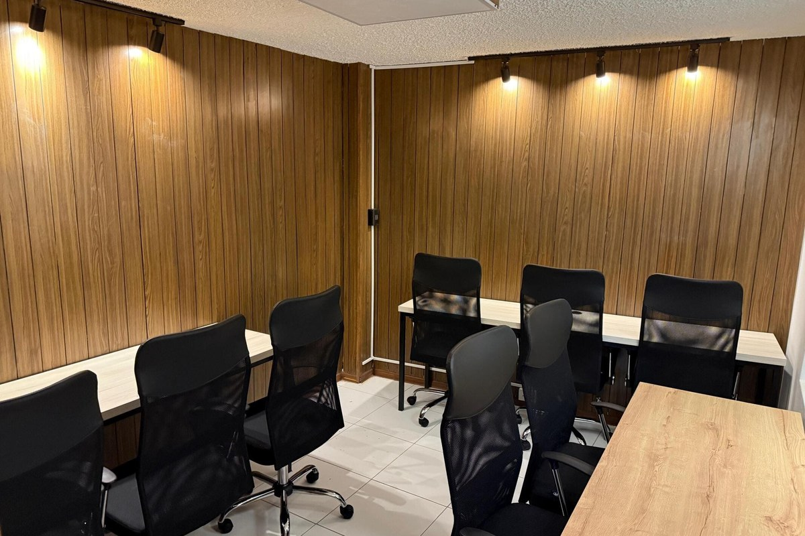 | [Espacio Coworking Arequipa](https://espacioaqp.com/)  📍 Yanahuara | Coworking con oficinas, salas, auditorio (15-20 p.) y sala audiovisual. | [🔗](https://espacioaqp.com/) |
| 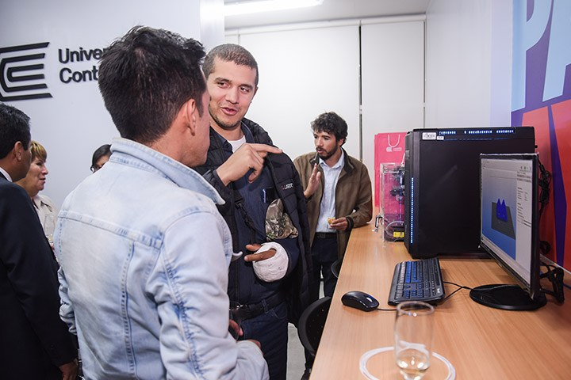 | [Fab Lab Continental – Arequipa](https://fablab.ucontinental.edu.pe/fab-lab-arequipa/)  📍 José Luis Bustamante y Rivero | Laboratorio de fabricación digital de la U. Continental (Lab A-708). | [🔗](https://fablab.ucontinental.edu.pe/fab-lab-arequipa/) |
| 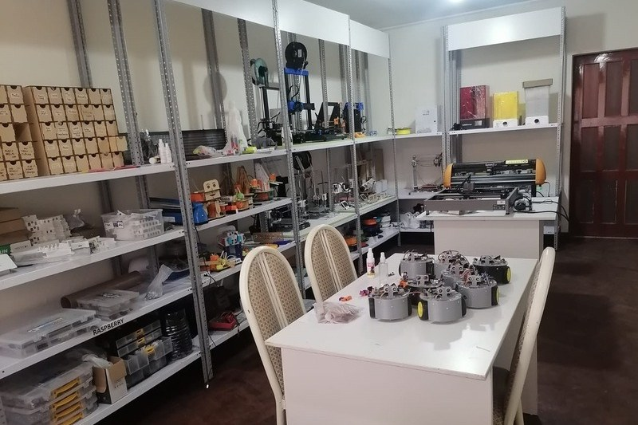 | [Fab Lab Código](https://fablab.pe/) | Fab lab/makerspace registrado en fablabs.io: impresión 3D, láser, CNC, electrónica, IoT. | [🔗](https://www.fablabs.io/labs/fablabcodigo) |
| 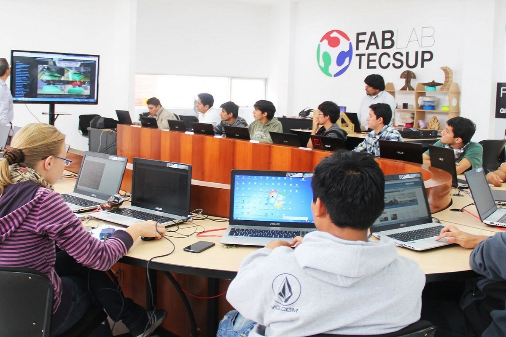 | [Fab Lab Tecsup – Arequipa](https://fablab.tecsup.edu.pe/)  📍 José Luis Bustamante y Rivero | Fab lab de Tecsup (red mundial Fab Lab) con sede en el campus Arequipa: impresión 3D, corte láser, CNC, prototipado, design thinking y Fab Academy; abierto a alumnos, emprendedores y empresas. | [🔗](https://fablab.tecsup.edu.pe/) |
| 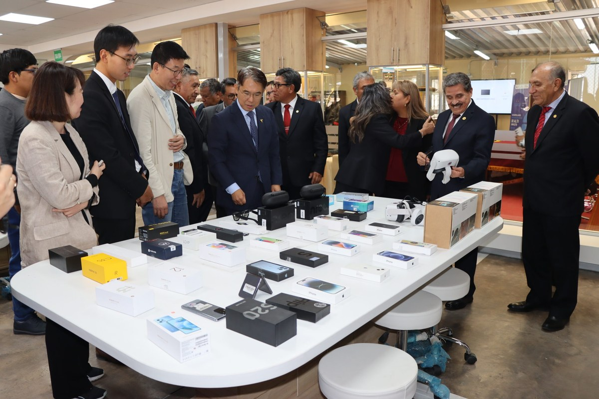 | [Laboratorio de Innovación Nodo Sur (UNSA–KOICA)](https://www.unsa.edu.pe/jaku/)  📍 Arequipa (Cercado) | Laboratorio TIC (IoT, realidad virtual, teleconferencia) para emprendedores, financiado por KOICA; nodo sur de la Red Universitaria de Innovación con UCSP y UCSM. (Es el 'Centro de Innovación' anunciado en 2021). | [🔗](https://www.unsa.edu.pe/unsa-y-corea-arequipa-cuenta-con-un-laboratorio-de-innovacion-para-emprendedores/) |
| 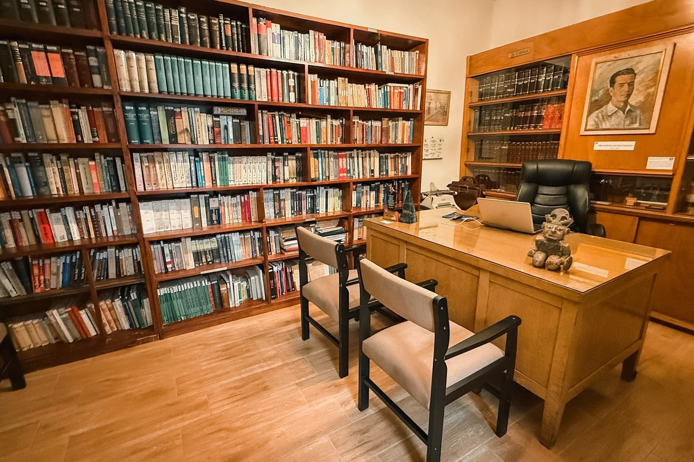 | **Museo Coworking & Casa Cultural Samuel Lozada Tamayo**  📍 Arequipa (Cercado) | Coworking y centro cultural en casona histórica. | [🔗](https://exa.ai/library/places?q=ecd8d40323efd6d1) |
| 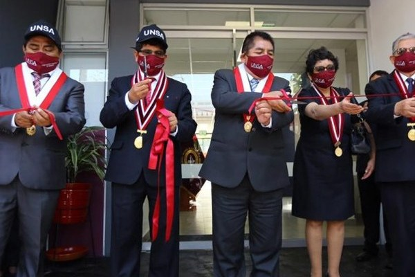 | [Parque Científico Tecnológico de Arequipa (UNSA)](https://vri.unsa.edu.pe/parque-cientifico-tecnologico-quienes-somos/)  📍 Arequipa (Parque Industrial) | Parque científico-tecnológico administrado por la UNSA (innovación, emprendimiento, desarrollo tecnológico). | [🔗](https://exa.ai/library/place/qcgnznxlx44) |
| 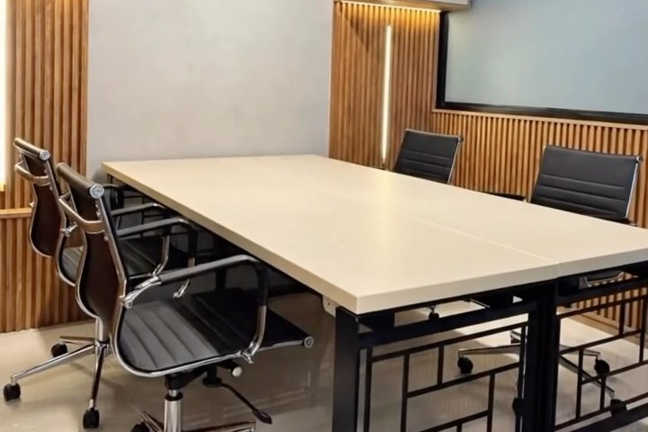 | [Prime Coworking Space](https://primecoworkspace.com/)  📍 Cerro Colorado | Coworking y oficina virtual en zona corporativa (Edificio City Center). | [🔗](https://primecoworkspace.com/) |
| 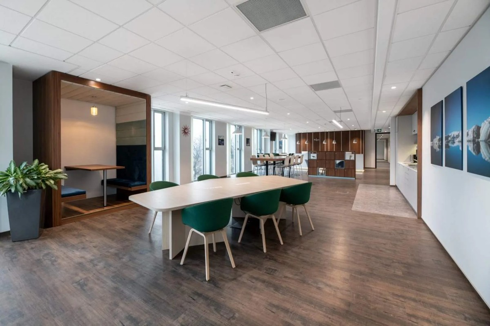 | [Regus Arequipa – La Pera](https://workin.space/en/peru/arequipa/regus-arequipa-la-pera)  📍 Cayma (según Regus/workin.space; Exa la ubica en Yanahuara) | Coworking y oficinas flexibles en los pisos 7, 10 y 11 del edificio El Peral; ex La Pera Coworking, incorporado a la red Regus (IWG) en jun-2026 como su primer centro fuera de Lima. | [🔗](https://es.linkedin.com/posts/fco-miranda_muy-orgulloso-de-compartir-este-importante-activity-7472405517290639360-aNOn) |

[⬆ volver](#contenido)

## 🏛️ Estado y programas

| | Actor | Descripción | Fuente |
|:-:|---|---|:-:|
|  | [CITE Agroindustrial Majes (ITP)](https://www.gob.pe/citeagroindustrial_majes)  📍 Majes (Caylloma) | CITE público del ITP para agroindustria en Majes (Caylloma). | [🔗](https://www.gob.pe/institucion/citeagroindustrial_majes/sedes) |
|  | [CITE Arequipa (artesanía – red CITE MINCETUR)](https://citearequipa.org/) | Institución sin fines de lucro de la red CITE de MINCETUR; innovación y articulación comercial para artesanos (plataforma QUIRAU). | [🔗](https://citearequipa.org/nosotros/) |
|  | [CITE Le Qara (artesanía y turismo)](https://leqara.com/)  📍 Sachaca | CITE privado de artesanía y turismo reconocido por MINCETUR (RM 075-2026); laboratorios de biotecnología para biocueros y biopigmentos, transferencia tecnológica y asistencia a artesanos. | [🔗](https://www.gob.pe/institucion/mincetur/normas-legales/7940798-075-2026-mincetur) |
|  | [CITE Textil Camélidos Arequipa (ITP)](https://www.gob.pe/citetextilcamelidos-arequipa)  📍 Cerro Colorado | CITE público del ITP/PRODUCE para la industria textil de camélidos (I+D+i, laboratorio, capacitación). | [🔗](https://www.gob.pe/institucion/citetextilcamelidos-arequipa/organizacion) |
|  | [CITEccal Arequipa – Cuero y Calzado (ITP)](https://www.gob.pe/institucion/citeccal-arequipa)  📍 Cerro Colorado | CITE público del ITP para cuero y calzado (información tecnológica, I+D+i, capacitación). | [🔗](https://www.gob.pe/institucion/citeccal-arequipa/contacto-y-numeros-de-emergencias) |
|  | [DER Arequipa 3.0 / Innova Arequipa (ProInnóvate – Dinamización de Ecosistemas Regionales)](https://www.gob.pe/institucion/proinnovate/campa%C3%B1as/140684-concursos-regionales-2026) | Programa regional de ProInnóvate (GORE CTI + UCSM): fondos para innovación empresarial, validación, emprendimiento innovador y dinámico. | [🔗](https://www.gob.pe/institucion/regionarequipa/noticias/1382783-gerencia-de-cti-promueve-fondos-no-reembolsables-para-4-sectores-de-la-region) |
|  | **Dirección Regional de la Producción – Arequipa** | Órgano regional de producción; articula con PRODUCE capacitación en IA y herramientas digitales para emprendedores. | [🔗](https://www.gob.pe/institucion/produce/noticias/1379010-estudiantes-tecnicos-y-emprendedores-de-arequipa-potencian-sus-conocimientos-en-ia-y-herramientas-digitales-de-la-mano-de-produce) |
|  | [Gerencia Regional de Ciencia, Tecnología e Innovación – Gobierno Regional de Arequipa](https://www.gob.pe/regionarequipa)  📍 Yanahuara | Primera gerencia regional de CTI del Perú; articula DER Arequipa 3.0 / Innova Arequipa con ProInnóvate. | [🔗](https://www.gob.pe/institucion/regionarequipa/noticias/1387665-gobierno-regional-de-arequipa-impulsa-financiamiento-de-startups-y-mipymes) |
|  | [Municipalidad Distrital de José Luis Bustamante y Rivero – capacitación empresarial](https://munibustamante.gob.pe)  📍 José Luis Bustamante y Rivero | Servicio municipal de capacitación empresarial y talleres para emprendedores. | [🔗](https://munibustamante.gob.pe/servicios/60-capacitacion-empresarial) |
|  | [Municipalidad Provincial de Arequipa – programas de emprendimiento](https://www.muniarequipa.gob.pe)  📍 Arequipa | Programa 'Joven Emprende' (100 colegios, con apoyo de INNICIA); promotor del festival FLIT. | [🔗](https://larevistadearequipa.pe/lanzamiento-del-programa-joven-emprende-para-100-colegios-en-arequipa/) |
|  | **Parque Tecnológico de Arequipa (GORE – proyecto)**  📍 Cayma | Parque tecnológico regional (5 pisos, laboratorio y data center) vía Obras por Impuestos en Cayma; plan maestro aprobado por Concytec. | [🔗](https://andina.pe/agencia/noticia-parque-tecnologico-arequipa-sera-una-realidad-y-fomentara-ecosistema-startups-1052020.aspx) |

[⬆ volver](#contenido)

## 🔬 Oficinas de innovación universitaria

| | Actor | Descripción | Fuente |
|:-:|---|---|:-:|
|  | [Centro de Innovación Tecsup – Arequipa](https://www.tecsup.edu.pe/centro-de-innovacion/)  📍 José Luis Bustamante y Rivero | Unidad de innovación de Tecsup: proyectos estudiantiles, hackatones, mentoría e incubadora Tecsup Ventures; en el campus Arequipa organiza la Feria Generación Innovadora (FerGI). | [🔗](https://aqpencontacto.pe/2026/07/10/tecsup-culmino-con-exito-la-iv-feria-generacion-innovadora-y-reconocio-los-mejores-proyectos-de-emprendimiento-e-innovacion/) |
|  | [Dirección de Innovación y Transferencia Tecnológica (UNSA)](https://vri.unsa.edu.pe) | Dirección del Vicerrectorado de Investigación de la UNSA; promotora del Laboratorio de Innovación KOICA. | [🔗](https://www.unsa.edu.pe/unsa-y-corea-arequipa-cuenta-con-un-laboratorio-de-innovacion-para-emprendedores/) |
|  | [Oficina de Innovación y Desarrollo (UCSM)](https://investigacion.ucsm.edu.pe/innicia/nosotros/) | Oficina de la UCSM de la que depende la incubadora INNICIA. | [🔗](https://investigacion.ucsm.edu.pe/innicia/nosotros/) |
|  | [OPTI – Oficina de Proyectos y Transferencia de la Investigación (UCSP)](https://ucsp.edu.pe/investigacion/opti/) | Gestiona transferencia tecnológica, propiedad intelectual, licenciamiento y spin-offs (p. ej. Zamenis Biotech/MABIS). | [🔗](https://ucsp.edu.pe/investigacion/opti/) |

[⬆ volver](#contenido)

## 🤝 Fundaciones

| | Actor | Descripción | Fuente |
|:-:|---|---|:-:|
|  | [Endeavor Perú](https://endeavor.org.pe/) | ONG nacional de alto impacto emprendedor (sede Lima); presencia en Arequipa vía 'Experiencia Endeavor Arequipa 2026' con U. Continental. Sin oficina en Arequipa. | [🔗](https://endeavor.org.pe/experiencia-endeavor-arequipa-2026/) |
|  | [NOSxOTROS Fundación Territorial Arequipa](https://nosxotros.org/) | Primera fundación territorial de Arequipa (2023): innovación social, PuPiLabs, censo territorial de impacto, articulación multisectorial. | [🔗](https://entrelineascultura.pe/2026/09/30/fundacion-arequipena-gana-el-principal-premio-de-innovacion-social-del-peru/) |

[⬆ volver](#contenido)

## 🧾 Cámaras y gremios

| | Actor | Descripción | Fuente |
|:-:|---|---|:-:|
|  | [ADEPIA – Asociación de Empresas del Parque Industrial de Arequipa](https://www.adepia.com.pe/)  📍 José Luis Bustamante y Rivero (Parque Industrial) | Gremio industrial (desde 1978); edita la revista Parque Industrial (cubre FLIT/tech). | [🔗](https://www.adepia.com.pe/contacto-adepia/) |
|  | [Cámara de Comercio e Industria de Arequipa (CCIA)](https://www.camara-arequipa.org.pe/)  📍 Yanahuara | Gremio empresarial (139 años); concurso escolar CRECE; socio de VINCULATECH 2026. | [🔗](https://www.camara-arequipa.org.pe/) |

[⬆ volver](#contenido)

## 📰 Medios

| | Actor | Descripción | Fuente |
|:-:|---|---|:-:|
|  | [AQPencontacto](https://aqpencontacto.pe/)  📍 Cerro Colorado | Portal digital de noticias de Arequipa; su sección Empresa cubre innovación, emprendimiento y tecnología regional (p. ej. FerGI Tecsup, UCSP). | [🔗](https://aqpencontacto.pe/contacto/) |
|  | [Arequipa Misti Press](https://arequipamistipress.com/) | Medio digital local; cobertura PCT UNSA y CCIA. | [🔗](https://arequipamistipress.com/2026/05/05/nuevo-consejo-directivo-de-ccia-2026-2027-juramenta-el-miercoles-06-y-conformaran-comision-de-etica/) |
|  | [Diario Correo – edición Arequipa](https://diariocorreo.pe/edicion/arequipa/) | Diario nacional con edición Arequipa; cubre fondos de innovación regionales. | [🔗](https://diariocorreo.pe/edicion/arequipa/arequipa-diez-proyectos-innovadores-recibiran-s16-millones-de-financiamiento-noticia/) |
|  | [Diario El Pueblo](https://diarioelpueblo.com.pe/)  📍 Arequipa (Cercado) | Diario arequipeño (sede Calle Sucre 213); cubre CCIA/emprendimiento. | [🔗](https://diarioelpueblo.com.pe/) |
|  | [Diario EP](https://diarioep.pe/)  📍 Arequipa | Diario con redacción en Arequipa ('La voz de las Regiones'); cubre Centro Digital Continental, Startup Weekend. | [🔗](https://es.linkedin.com/posts/diario-ep_nuevaoficina-crecemosjuntos-diarioep-activity-7436084546481160192-5pYs) |
|  | [Diario Los Andes](https://losandes.com.pe/) | Diario del sur; cobertura de hackatones locales. | [🔗](https://losandes.com.pe/convocan-a-jovenes-para-transformar-el-sector-turismo-con-la-hackaton-touriston/) |
|  | [Diario Viral](https://diarioviral.pe/)  📍 Arequipa (Cercado) | Medio digital arequipeño; cobertura de GORE CTI y NASA Space Apps Arequipa. | [🔗](https://exa.ai/library/place/tmgkf2tcsfc) |
|  | [El Búho](https://elbuho.pe/) | Medio digital con sede en Arequipa ('Noticias desde Arequipa'); cobertura de NOSxOTROS y sociedad civil. Dirección física no publicada. | [🔗](https://elbuho.pe/quienes-somos/) |
|  | [Encuentro](https://encuentro.pe/) | Medio arequipeño; sección Emprendimiento (cobertura Kaman/UCSP). | [🔗](https://encuentro.pe/emprendimiento/la-revolucion-de-la-ia-en-las-ventas-llego-a-arequipa/) |
|  | [Entre Líneas Cultura](https://entrelineascultura.pe/) | Medio cultural; cobertura de NOSxOTROS (Premio Kunan 2026). | [🔗](https://entrelineascultura.pe/2026/09/30/fundacion-arequipena-gana-el-principal-premio-de-innovacion-social-del-peru/) |
|  | [La Revista de Arequipa](https://larevistadearequipa.pe/) | Revista/medio digital local; cobertura de programas municipales de emprendimiento. | [🔗](https://larevistadearequipa.pe/lanzamiento-del-programa-joven-emprende-para-100-colegios-en-arequipa/) |
|  | [Radio San Martín (97.7 FM)](https://radiosanmartin.pe/) | Radio arequipeña; cubrió Experiencia Endeavor Arequipa 2026. Dirección no verificada en fuente primaria. | [🔗](https://radiosanmartin.pe/2026/06/24/arequipa-sera-sede-de-la-primera-edicion-de-experiencia-endeavor-el-principal-encuentro-de-emprendedores-del-pais/) |
|  | [Radio Yaraví](https://radioyaravi.org.pe/)  📍 Arequipa (Cercado) | Radio arequipeña con sección 'Empresarial' sobre emprendimiento y mypes. | [🔗](https://radioyaravi.org.pe/contacto/) |

[⬆ volver](#contenido)

## 💰 Fondos e inversión

_Sin actores verificados aún. ¿Conoces un fondo o red de inversión activa en Arequipa? Abre un issue con su fuente pública._

[⬆ volver](#contenido)

## 📅 Eventos

| | Actor | Descripción | Fuente |
|:-:|---|---|:-:|
|  | [Arequipa Game Jam (Global Game Jam Arequipa)](https://arequipagamejam.org/) | Sede arequipeña de la Global Game Jam. Organizan: ACM UNSA, ACM UCSP, IEEE UNSA y Volcán Game Lab. Frecuencia: anual (calendario GGJ, enero). Última edición: 26–31 ene 2026 en la UNSA (área de Ingenierías). | [🔗](https://globalgamejam.org/jam-sites/2026/arequipa-game-jam-2026) |
|  | [Arequipa Tech Week](https://luma.com/ArequipaTechWeek) | Semana del ecosistema de innovación de Arequipa. Organiza: Startup Grind Arequipa con Fundación NOSxOTROS, Gerencia Regional de CTI, Innicia y Wichay. Frecuencia: anual (1.ª edición 2026). Última edición: 22–27 jun 2026. | [🔗](https://entrelineascultura.pe/2026/06/24/arequipa-tech-week-2026-reunira-a-los-principales-actores-del-ecosistema-de-innovacion-de-la-region/) |
|  | [DevFest Arequipa](https://gdg.community.dev/events/details/google-gdg-arequipa-presents-devfest-arequipa-2026/) | Conferencia de tecnologías Google y open source. Organiza: GDG Arequipa. Frecuencia: anual con interrupciones (2022, 2024, 2026). Última edición: 26 oct 2024 en el CIP Arequipa; próxima: 7 nov 2026 en Tecsup. | [🔗](https://gdg.community.dev/events/details/google-gdg-arequipa-presents-devfest-arequipa-2026/) |
|  | [FLIT – Festival de Tecnología e Innovación](https://flit.com.pe/)  📍 Arequipa (Cercado) | Festival de tecnología e innovación del sur del Perú (charlas, hackatón de IA, demo day). Organiza: Link Perú con la Municipalidad Provincial, la CCIA y el Gobierno Regional. Frecuencia: anual desde 2023. Última edición (4.ª): 15–19 jul 2026, Palacio Metropolitano de Bellas Artes. | [🔗](https://flit.com.pe/) |
|  | [NASA Space Apps Challenge – Arequipa](https://www.spaceappschallenge.org/2025/local-events/arequipa/) | Sede local del hackatón global de la NASA. Organiza: capítulo local (2025 con la Universidad Continental; 2026 en la UCSM). Frecuencia: anual. Última edición (4.ª): 4–5 oct 2025; próxima: 14–15 nov 2026 en la UCSM. | [🔗](https://www.spaceappschallenge.org/2025/local-events/arequipa/) |
|  | [Premio Orgullo Emprendedor (Caja Arequipa)](https://www.cajaarequipa.pe/orgullo-emprendedor/) | Concurso y premiación para emprendedores, con categoría Emprendimiento Innovador. Organiza: Caja Arequipa. Frecuencia: anual (2024, 2025, 2026). Edición en curso: 3.ª; premiación 11 nov 2026. | [🔗](https://www.cajaarequipa.pe/orgullo-emprendedor/) |
|  | [Volcán Game Jam](https://itch.io/jam/volcan-game-jam-2025) | Game jam presencial de 48 h. Organiza: Volcán Game Lab con ACM UCSP y el Departamento de Computación de la UCSP. Frecuencia: anual (1.ª en 2025, Instituto Thomas Jefferson). Última edición: 20–22 jul 2026, UCSP San Lázaro. | [🔗](https://es.linkedin.com/posts/volcan-game-lab_volcangamejam-gamejam2026-desarrollodevideojuegos-activity-7479276648056541185-Q8sW) |

[⬆ volver](#contenido)

## 🕸️ Redes

| | Actor | Descripción | Fuente |
|:-:|---|---|:-:|
|  | **NODOS – Ecosistema de Mentores** | Red de mentores del ecosistema emprendedor de Arequipa liderada por Pía Rivas, con Astrid Puma y Joselin Layme; dictó el 1er Programa de Gestión de Red de Mentores para Incubadoras (may–jun 2026) con apoyo de Swiss EP / Swisscontact. | [🔗](https://es.linkedin.com/posts/piarivaslozada_nodos-activity-7455088475479142400-qsg1) |
|  | **RUI – Red Universitaria de Innovación, Nodo Sur** | Red de innovación de universidades del sur: UNSA, UCSM y UCSP (Arequipa), UPT (Tacna) y UNAM (Moquegua). Organiza la Hackathon Innova Sur con retos de empresas (EGESUR, YURA, ORICA). | [🔗](https://rpu.edu.pe/investigacion/noticias/universidades-de-la-rpu-participaran-en-hackaton-innova-sur/) |

[⬆ volver](#contenido)

## 🚀 Startups

| | Actor | Descripción | Fuente |
|:-:|---|---|:-:|
|  | [Arcux](https://arcux.net/es/) | Plataforma arequipeña de educación online para arquitectos, ingenieros y diseñadores (desde 2018); declara +80 mil estudiantes y +80 cursos. Ganadora de Startup Perú 8G; en el listado Forbes Perú de las 100 mejores startups 2025. | [🔗](https://encuentro.pe/emprendimiento/educacion-que-traspasa-fronteras/) |
|  | **AVIRÚ** | Startup arequipeña de egresados de la UNSA: dispositivo IoT en la cabina de camiones y buses que muestra la velocidad y avisa por voz antes de curvas peligrosas. Incubada en JAKU Emprende; apoyada por ProInnóvate. | [🔗](https://www.unsa.edu.pe/aviru-tecnologia-que-salva-vidas-en-carreteras-arequipenas/) |
|  | [Ayphu](https://ayphu.com/) | Startup arequipeña (2022) de infraestructura cloud, DevSecOps y hosting de aplicaciones open source. En el listado Forbes Perú de las 100 mejores startups 2025. | [🔗](https://ayphu.com/es/nosotros) |
|  | **Delta Dispatch** | Startup arequipeña que digitaliza la seguridad ciudadana municipal: coordina serenazgo, policía y bomberos con geolocalización e IA. Desde dic-2023; ~95 mil emergencias gestionadas y 10 municipios clientes. | [🔗](https://encuentro.pe/emprendimiento/de-las-obras-inconclusas-a-las-clinicas-inteligentes-startups-que-innovan-desde-las-regiones/) |
|  | **Dentito** | Startup arequipeña de salud digital: automatiza la gestión de consultorios (citas, recordatorios y atención por WhatsApp con IA). Incubada en Kaman (UCSP); adquirida por DocToc Health en jun-2026, el primer 'exit' de Arequipa. | [🔗](https://gestion.pe/economia/empresas/arequipa-suma-su-primer-exit-startup-de-salud-digital-es-adquirida-por-doctoc-noticia/) |
|  | **Futurum** | Startup arequipeña de edtech fundada por egresados de la UNSA: plataforma (LMS) para que docentes independientes gestionen clases, materiales, horarios y seguimiento de alumnos y familias. | [🔗](https://andina.pe/agencia/noticia-arequipa-startup-impulsa-plataforma-busca-cambiar-educacion-personalizada-peru-1085666.aspx) |
|  | **Hem.AI** | Startup de estudiantes de la UCSM que convierte el smartphone en un microscopio clínico con IA para detectar anemia, malaria y Chagas. Ganó la Hackathon HSIL 2026 (Harvard Health Systems Innovation Lab, Chile). | [🔗](https://larepublica.pe/sociedad/2026/05/25/de-arequipa-a-harvard-estudiantes-peruanos-desarrollan-tecnologia-para-detectar-malaria-y-anemia-desde-un-celular-1596125) |
|  | [Jebi](https://jebi.ai/) | Startup arequipeña (desde 2019) de IA y visión por computadora para minería: monitoreo de dientes de cucharón (GET), desgaste y granulometría. Premio PERUMIN Hub 2025 ('Innovaciones exitosas'). | [🔗](https://jebi.ai/about) |
|  | **Nanovida** | Empresa biotecnológica arequipeña de productos con nanopartículas de cobre (desinfectantes y Nanovida Gel cicatrizante). Patente nacional de Indecopi (2025) para su gel; capital semilla de ProInnóvate. | [🔗](https://www.gob.pe/institucion/proinnovate/noticias/1208438-arequipenos-obtienen-patente-para-gel-que-triplica-la-velocidad-de-cicatrizacion-de-heridas-agudas) |
|  | **Zamenis** | Startup biomédica surgida en la UCSP; desarrolla MABIS, un brasier con imágenes por microondas para la detección temprana de anomalías mamarias. Financiada por ProInnóvate y seleccionada en el programa BAILA de JICA (Japón, 2025). | [🔗](https://www.gob.pe/institucion/proinnovate/noticias/1267815-investigadores-arequipenos-presentan-tecnologia-de-deteccion-temprana-de-cancer-de-mama-en-japon) |

[⬆ volver](#contenido)

## Datos

- `data/ecosistema_arequipa.csv` / `.json`: directorio completo (`cover_path` = imagen en este repo, `cover_url` = imagen original, `cover_source_page`, `cover_kind` = foto | preview (imagen de vista previa/portada oficial) | logo, `lat`/`lng` cuando se conocen).
- `data/pampam_import.csv`: spots para importar en PamPam.
- `assets/covers/`: portadas 3:2 (≤1200 px) + `SOURCES.md` con créditos.

Regenera este README con `python3 scripts/build_readme.py`.

## Contribuir

Abre un issue con el actor, una fuente pública y la fecha de verificación. Solo organizaciones; sin datos personales.

## Licencia

Datos y texto: ver [LICENSE](LICENSE). Las imágenes pertenecen a sus autores (ver `SOURCES.md`).
